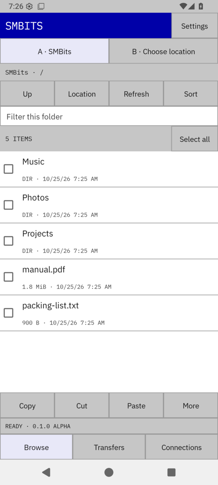
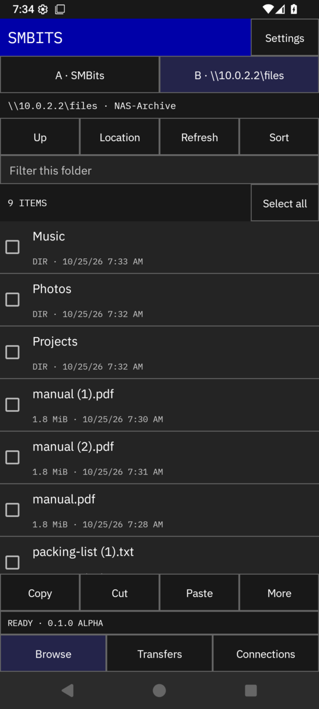
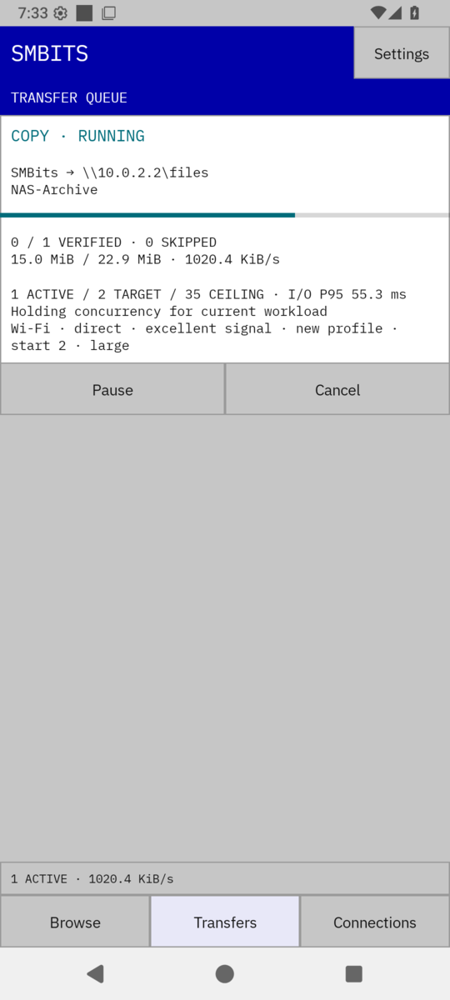
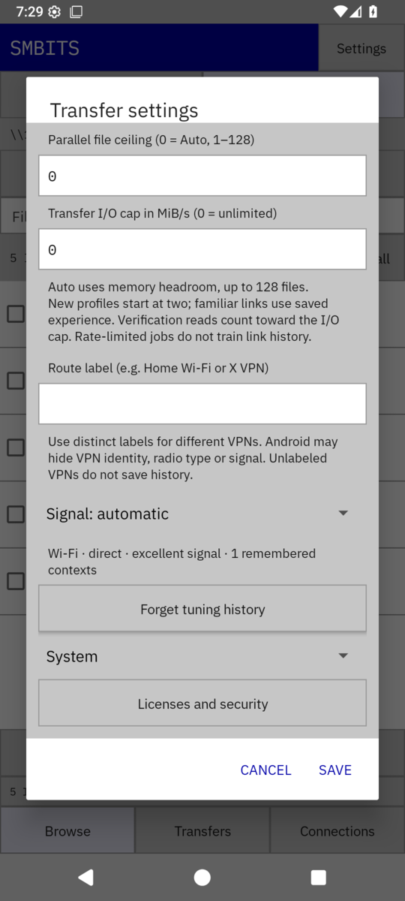

# SMBits

Android file manager for local folders and SMB shares, built for moving a lot of files quickly. It copies several files at once, like robocopy `/MT`, and adjusts how many to run in parallel from the throughput and latency it measures. It remembers what worked on each network and share, so a repeat transfer over the same link starts near the right setting.

Every copied file is read back and checked with SHA-256 before it counts as done, and a move deletes its source only after that check passes. SMB connections require SMB 3 encryption by default.

<table>
  <tr>
    <td></td>
    <td></td>
    <td></td>
    <td></td>
  </tr>
  <tr>
    <td>Local folder</td>
    <td>SMB share, dark theme</td>
    <td>Copy in progress</td>
    <td>Transfer settings</td>
  </tr>
</table>

> **Status: alpha (0.1.0-alpha.2).** Tested on an Android 16 emulator against Samba test servers. Physical phones and real Wi-Fi, 5G, VPN and NAS performance have not been measured yet. Results and limits are in [docs/validation.md](docs/validation.md).

## Download

Get `smbits-<version>.apk` from [Releases](https://github.com/thereprocase/smbits/releases). Android 9 or newer. Each release lists the APK's SHA-256 in `SHA256SUMS`:

```sh
sha256sum -c SHA256SUMS
```

Android asks you to allow installs from the app you open the APK with. Release APKs are signed with one key; later releases install over earlier ones and keep your saved locations and tuning history. The signing certificate's SHA-256 is

```
ab0439be48801401b8a645e17c4cb776961dd24ab498983b69af527cd3789a0e
```

and `apksigner verify --print-certs smbits-<version>.apk` prints it.

## Features

- Two independent browsing locations, A and B, with folder history and Up navigation.
- Local folders selected through Android's Storage Access Framework; internal storage, removable storage, and document providers depend on Android's picker and grants.
- Direct UNC and `smb://` connections, optional port, domain credentials, saved locations, and optional Keystore-protected password storage.
- Multi-select, copy, cut, paste, new folders, rename, explicit permanent deletion, properties, and local Open/Share.
- Name/size/date sorting, hidden files, folder filtering, and bounded recursive filename search.
- Queued foreground transfers with pause, resume, cancel, per-job errors, throughput, worker count, and measured I/O latency.
- Parallel files with adaptive concurrency, an automatic memory-based ceiling (or a user ceiling of 1–128), and an aggregate stream-byte rate cap.
- Private tuning history by link type, signal quality, route label, source/destination root, security mode, direction, and workload size. Familiar contexts reuse a measured starting concurrency.
- SHA-256 destination readback before publishing a completed file. Moves re-read the source before deletion.
- Existing-file policies: report, skip, keep both, and replace after verification. Replacement stages the old destination under a backup name until publication succeeds.

## Use

1. Open **Location → Choose local folder**, or **Connect to SMB share**.
2. For SMB, enter `\\server\share` (optionally a subfolder), username, password, and domain if required. Default port: 445.
3. Default security requires SMB 3 encryption. Explicit compatibility mode permits SMB 2/3 with required signing and potentially unencrypted payloads. SMB 1, guest sessions, and automatic security downgrade are refused.
4. Select items using checkboxes or a long press, then **Copy** or **Cut**. Choose the destination in A or B and tap **Paste**.
5. In **Settings**, give distinct networks or VPN routes a label when needed (for example, `Home Wi-Fi` or `X VPN`). Signal detection has a manual override. Unlabeled VPNs do not save tuning history. **Forget tuning history** clears learned starts.
6. Choose the conflict policy. Review progress and errors in **Transfers**. Settings apply to new jobs.

Android grants access only to the folders the user selects. Android may prohibit selecting storage roots, Downloads roots, or Android/data and Android/obb. The app does not request all-files access, root, or administrator access. To open a remote file in another app, copy it to a selected local folder first.

## Build

Requires JDK 17, Android SDK platform 36 and build tools 36.0.0. Android 9/API 28 is the minimum target; see the validation matrix before assuming support on a particular device.

```sh
export JAVA_HOME=/path/to/jdk-17
export ANDROID_HOME=/path/to/android-sdk
./gradlew --no-daemon --max-workers=2 :core:test :app:lintDebug :app:assembleDebug
./scripts/build-review.sh
```

`build-review.sh` creates a private local signing key on first use under `~/.config/smb-files/signing/`, outside the source tree. Keep that key to install future builds over this one. It builds a non-debuggable APK, runs tests/lint, writes `artifacts/smbits-0.1.0-alpha.2.apk`, and verifies its signature. Signing is local; this is not a Play Store release or an independently audited product.

Runtime dependency versions are locked and artifact checksums are checked by Gradle. Intentional upgrades must review changes to the lockfiles, checksum metadata, notices, and dependency audit. Do not regenerate verification metadata merely to silence a mismatch.

## Scope and limits

The adaptive controller measures this app's throughput and latency. New contexts start with two workers, while familiar contexts reuse local history subject to memory headroom and the user ceiling. See [tuning behavior](docs/tuning.md) for learning, expiry, network detection limits, and resource estimates. It does not discover a mathematical maximum link rate or reserve bandwidth against other applications. File-level concurrency resembles robocopy `/MT`; SMB Multichannel, RDMA, and parallel ranges within one large file are not implemented. Performance on real phones, Wi-Fi, slow NAS devices, and mixed workloads still requires measurement.

Jobs survive activity recreation while the process and foreground service remain alive. Process death does not automatically resume a job. An interrupted-session warning directs the user to inspect partial files and retry. Android's foreground-service limits still apply. No background transfer is silently relaunched after force-stop or reboot.

SHA-256 verifies file contents, not ACLs, alternate data streams, ownership, timestamps, sparse allocation, or other metadata. Symlinks/reparse points are refused by the SMB provider. Arbitrary document providers can have different rename, flush, and durability semantics; see [security and correctness](docs/security.md). Archive browsing/extraction, thumbnails, server/share discovery, DFS referrals, a recycle bin, and a permissions editor are not implemented in this alpha.

## License

App code: [MIT](LICENSE). Runtime dependencies: Apache-2.0 and MIT or MIT-style licenses. Bundled fonts: SIL OFL-1.1. Full notices are available inside **Settings → Licenses and security** and in [app/src/main/assets/licenses](app/src/main/assets/licenses). See [dependency review](docs/dependencies.md).
